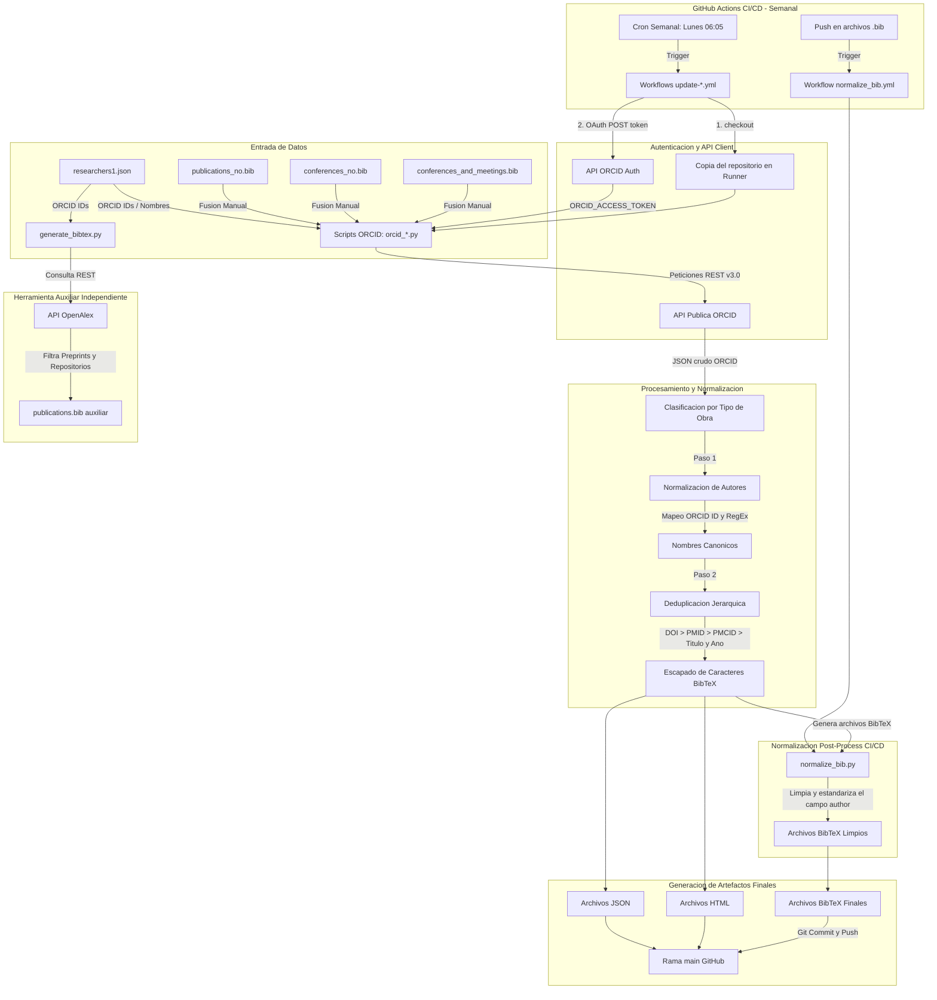

# Sistema de Gestión Bibliográfica Automatizada desde ORCID y OpenAlex

Este repositorio contiene un sistema automatizado desarrollado en Python y GitHub Actions para la extracción, normalización, clasificación, deduplicación y generación de bibliografías académicas en formatos **BibTeX (`.bib`)**, **JSON** y **HTML** a partir de los perfiles de **ORCID** (fuente principal) y la API de **OpenAlex** (herramienta auxiliar).

---

## 📋 Índice

- [Descripción General](#descripción-general)
- [Diagrama Explicativo del Flujo del Sistema](#diagrama-explicativo-del-flujo-del-sistema)
- [Estructura del Repositorio](#estructura-del-repositorio)
  - [Scripts en Python (`.py`)](#scripts-en-python-py)
  - [Workflows de GitHub Actions (`.yml`)](#workflows-de-github-actions-yml)
- [Características Principales](#características-principales)
- [Detalle de la Normalización y Deduplicación de Autores](#detalle-de-la-normalización-y-deduplicación-de-autores)
  - [Capa A: Normalización Directa por ORCID ID](#capa-a-normalización-directa-por-orcid-id)
  - [Capa B: Mapeo por Diccionario de Variantes](#capa-b-mapeo-por-diccionario-de-variantes)
  - [Capa C: Normalización Estricta y Escapado en BibTeX](#capa-c-normalización-estricta-y-escapado-en-bibtex)
- [Explicación Detallada del Flujo de GitHub Actions](#explicación-detallada-del-flujo-de-github-actions)
  - [Eventos Disparadores (`on:`)](#eventos-disparadores-on)
  - [Secuencia de Pasos en el Runner](#secuencia-de-pasos-en-el-runner)
  - [Control de Concurrencia y Permisos](#control-de-concurrencia-y-permisos)
- [Archivos de Entrada y Salida](#archivos-de-entrada-y-salida)
  - [Entrada](#entrada)
  - [Complemento Manual de Referencias](#complemento-manual-de-referencias)
  - [Salida Generada](#salida-generada)
- [Configuración y Requisitos](#configuración-y-requisitos)
  - [Requisitos de Python](#requisitos-de-python)
  - [Secretos de GitHub Actions](#secretos-de-github-actions)
- [Guía de Uso](#guía-de-uso)
  - [Ejecución en Local](#ejecución-en-local)
  - [Ejecución Automatizada en GitHub Actions](#ejecución-automatizada-en-github-actions)

---

## Descripción General

El sistema permite mantener actualizada automáticamente la producción científica de un grupo de investigadores. A partir de un archivo JSON (`researchers1.json`) que contiene los nombres y **ORCID IDs** de cada investigador:

1. **Flujo Principal (ORCID)**: El núcleo del sistema consulta semanalmente la API pública v3.0 de **ORCID** para extraer, clasificar (artículos de revista, congresos y otros trabajos), normalizar autores y deduplicar registros.
2. **Integración Híbrida con Referencias Manuales**: Se fusionan los datos extraídos de ORCID con archivos `.bib` manuscritos (`publications_no.bib`, `"conferences_no.bib"`, `conferences_and_meetings.bib`") para incorporar aportaciones o ponencias que no figuren en la plataforma de ORCID sin generar duplicados.
3. **Herramienta Auxiliar (OpenAlex)**: Se incluye el script `generate_bibtex.py` como utilidad independiente para realizar consultas secundarias o complementarias en la API de **OpenAlex**.
4. **Generación Multiformato**: Produce automáticamente archivos `.bib`, `.json` y `.html` listos para su difusión o inclusión en la web institucional.

---

## Diagrama Explicativo del Flujo del Sistema

El siguiente diagrama ilustra la arquitectura del sistema, destacando el **flujo principal automatizado con ORCID**, la **integración de referencias manuales**, la **normalización CI/CD con GitHub Actions** y el **script auxiliar con OpenAlex**:



    subgraph Workflows [GitHub Actions CI/CD - Semanal]
        Cron[Cron Semanal: Lunes 06:05] -->|Trigger| GHA_Update[Workflows update-*_.yml]
        PushBib[Push en archivos .bib] -->|Trigger| GHA_Norm[Workflow normalize_bib.yml]
    end

    subgraph Auth [Autenticacion y API Client]
        GHA_Update -->|1. checkout| RepoCopy[Copia del repositorio en Runner]
        GHA_Update -->|2. OAuth POST token| OAuth[API ORCID Auth]
        OAuth -->|ORCID_ACCESS_TOKEN| B
        RepoCopy --> B
        B -->|Peticiones REST v3.0| ORCID_API[API Publica ORCID]
    end

    subgraph Process [Procesamiento y Normalizacion]
        ORCID_API -->|JSON crudo ORCID| C[Clasificacion por Tipo de Obra]
        C -->|Paso 1| D[Normalizacion de Autores]
        D -->|Mapeo ORCID ID y RegEx| D1[Nombres Canonicos]
        D1 -->|Paso 2| E[Deduplicacion Jerarquica]
        E -->|DOI > PMID > PMCID > Titulo y Ano| F[Escapado de Caracteres BibTeX]
    end

    subgraph NormStep [Normalizacion Post-Process CI/CD]
        GHA_Norm --> N1[normalize_bib.py]
        F -->|Genera archivos BibTeX| N1
        N1 -->|"Limpia y estandariza el campo author"| N2[Archivos BibTeX Limpios]
    end

    subgraph Salida [Generacion de Artefactos Finales]
        F --> OutJSON[Archivos JSON]
        F --> OutHTML[Archivos HTML]
        N2 --> OutBIB[Archivos BibTeX Finales]
        OutJSON --> MainRepo[Rama main GitHub]
        OutHTML --> MainRepo
        OutBIB -->|Git Commit y Push| MainRepo
    end

    subgraph Auxiliar [Herramienta Auxiliar Independiente]
        OA_Script -->|Consulta REST| OpenAlex_API[API OpenAlex]
        OpenAlex_API -->|Filtra Preprints y Repositorios| OA_BIB[publications.bib auxiliar]
    end

---

## Estructura del Repositorio

```
.
├── .github/workflows/
│   ├── update-publications.yml   # Workflow semanal para artículos de revista (ORCID)
│   ├── update_conferences.yml    # Workflow semanal para actas/comunicaciones de congresos (ORCID)
│   ├── update-other-works.yml    # Workflow semanal para otros trabajos académicos (ORCID)
│   └── normalize_bib.yml         # Workflow disparado al modificar archivos .bib
│
├── orcid_publications.py              # Extracción y procesado de artículos de revista desde ORCID
├── orcid_conferences.py               # Extracción y procesado de ponencias/congresos desde ORCID
├── orcid_other_works.py               # Extracción y procesado de otros trabajos desde ORCID
├── normalize_bib.py                   # Limpieza y normalización de firmas de autores en BibTeX
│
├── generate_bibtex.py                 # [Auxiliar] Extracción y generación de BibTeX desde OpenAlex API
│
├── researchers1.json                  # Archivo de entrada con el listado de investigadores y ORCIDs
├── publications_no.bib                # [Manual] Artículos de revista no presentes en ORCID
├── conferences_no.bib                 # [Manual] Papers de conferencias no presentes en ORCID
├── conferences_and_meetings.bib       # [Manual] Otros trabajos (capítulos, informes, presentaciones orales, pósters) no presentes en ORCID
└── README.md                          # Documentación del proyecto
```

### Scripts en Python (`.py`)

#### Flujo Principal (API ORCID)
- **`orcid_publications.py`**:
  - Conecta a la API v3.0 de ORCID (`pub.orcid.org`).
  - Procesa la lista de investigadores de `researchers1.json`.
  - Fusiona las publicaciones de ORCID con `publications_no.bib`.
  - Filtra artículos de revista e implementa deduplicación y normalización.
  - Genera `publications.bib`, `publications.json` y `publications.html`.

- **`orcid_conferences.py`**:
  - Extrae publicaciones de congresos desde ORCID.
  - Fusiona con las ponencias/pósteres locales de `conferences_no.bib`.
  - Implementa filtros específicos (`looks_like_conference`).
  - Genera `conference_publications.bib`, `conference_publications.json` y `conference_publications.html`.

- **`orcid_other_works.py`**:
  - Recupera libros, capítulos, informes, preprints, patentes y datasets desde ORCID.
  - Fusiona con `conferences_and_meetings.bib`.
  - Construye un mapa canónico de nombres por ORCID ID.
  - Genera `other_works.bib`, `other_works.json` y `other_works.html`.

#### Post-Procesamiento de Bibliografía
- **`normalize_bib.py`**:
  - Normaliza firmas de autores en archivos `.bib` a iniciales y apellidos oficiales.
  - Escapa caracteres especiales en LaTeX/BibTeX (`&`, `%`, `#`, `_`, `{`, `}`).

#### Herramienta Auxiliar (API OpenAlex)
- **`generate_bibtex.py`**:
  - Utility independiente para consultar la API de OpenAlex por ORCID ID.
  - Descarta preprints y repositorios de datos (Zenodo, arXiv, Figshare, OSF).
  - Genera un `publications.bib` alternativo con claves autor-año.

### Workflows de GitHub Actions (`.yml`)

- **`update-publications.yml`**: Sincronización semanal de artículos de revista desde ORCID.
- **`update_conferences.yml`**: Sincronización semanal de actas y comunicaciones de congresos desde ORCID.
- **`update-other-works.yml`**: Sincronización semanal de otros trabajos científicos desde ORCID.
- **`normalize_bib.yml`**: Integración continua que estandariza automáticamente cualquier archivo `.bib` modificado en el repositorio.

---

## Características Principales

- **Sincronización Automática Semanal**: Mantiene la producción científica al día de forma desatendida mediante GitHub Actions.
- **Uso Oficial de API ORCID**: Autenticación segura mediante OAuth 2.0 Client Credentials (`/read-public`).
- **Integración Híbrida Manual + API**: Permite completar el catálogo científico incluyendo referencias escritas a mano que no figuren en ORCID.
- **Normalización Estricta de Autores**: Mapeo inteligente de firmas de autor para corregir variantes de acentuación, guiones e iniciales.
- **Escapado de Caracteres BibTeX**: Manejo correcto de caracteres especiales (`&`, `%`, `#`, `_`, `{`, `}`) evitando errores de compilación en LaTeX.
- **Deduplicación Robusta**: Detección de duplicados basada en jerarquía: `DOI` → `PMID` → `PMCID` → `Título + Año + Revista`.
- **Multiformato de Salida**: Salidas estructuradas en `.bib` (para LaTeX/Mendeley/Zotero), `.json` (para APIs internas) y `.html` (para renderizado directo en la web).

---

## Detalle de la Normalización y Deduplicación de Autores

El proceso de normalización de nombres de autores se ejecuta en tres capas complementarias dentro del código para garantizar firmas bibliográficas uniformes y sin errores de sintaxis:

### Capa A: Normalización Directa por ORCID ID
En la extracción de datos desde ORCID (`orcid_other_works.py`), el sistema prioriza la identidad única del investigador antes que el texto registrado en el trabajo:
1. **Mapa Canónico por ORCID**: Se construye una tabla `canonical_by_orcid` en la que cada `ORCID ID` extraído de `researchers1.json` se vincula estrictamente a su nombre oficial preferido.
2. **Sustitución Directa**: Al leer los contribuidores de cada obra, si el contribuidor tiene un `contributor-orcid` coincidente, el script reemplaza el nombre escrito por el nombre canónico oficial.
3. **Fallback por Firma de Nombre**: Si el registro en ORCID carece del ID del coautor, se genera una firma conservadora (`name_signature`) basada en la primera inicial y el primer apellido normalizado para identificar al investigador.

### Capa B: Mapeo por Diccionario de Variantes
En `orcid_publications.py` y `orcid_conferences.py`, se utiliza una función de normalización de claves (`normalize_author_key`) que elimina tildes, diacríticos, mayúsculas y guiones, mapeando variantes frecuentes a su firma oficial.

### Capa C: Normalización Estricta y Escapado en BibTeX
Cuando se procesan o refinan los archivos `.bib`, el script `normalize_bib.py` realiza un escaneo de los campos `author = {...}` separando cada autor por el delimitador `and`:
1. **Captura por Expresión Regular**: Para los investigadores principales, evalúa patrones de búsqueda flexibilizados (ej. `Díaz de María`) y reescribe la entrada exactamente como la firma oficial.
2. **Formateo Genérico de Coautores**: Para el resto de autores no principales (`generic_clean_author`), convierte los nombres de pila en iniciales en mayúsculas (ej. "Juan Manuel" -> "J. M.") y los estructura bajo el formato estándar `Apellido, Iniciales`.
3. **Escapado Seguro de BibTeX**: Escapa caracteres reservados en LaTeX/BibTeX (tales como `&`, `%`, `#`, `_`, `{`, `}`) agregando barras invertidas para evitar fallos de sintaxis en procesadores bibliográficos.

### Tabla de Mapeo de Investigadores Principales

| Nombre Canónico | Variantes Detectadas y Normalizadas |
| :--- | :--- |
| **Díaz-de-María, F.** | `Fernando Díaz de María`, `Diaz-De-Maria, F.`, `Fernando, D.-D.-M.` |
| **Gallardo-Antolín, A.** | `Ascensión Gallardo Antolín`, `Gallardo_Antolín, A.`, `ASCENSIÓN GALLARDO-ANTOLÍN` |
| **Peláez-Moreno, C.** | `Carmen Peláez Moreno`, `Carmen Pelaez-Moreno`, `Carmen Peláez` |
| **González-Díaz, I.** | `Iván González Díaz`, `González Díaz, Iván`, `Gonzalez-Diaz, I.` |
| **Fernández-Torres, M. A.** | `Miguel Ángel Fernández Torres`, `Fernández Torres, M.A.` |

---

## Explicación Detallada del Flujo de GitHub Actions

La automatización de la integración continua (CI/CD) se organiza mediante cuatro workflows YAML dentro de `.github/workflows/`:

### Eventos Disparadores (`on:`)
- **Programación Semanal (`schedule`)**: Los workflows `update-publications.yml`, `update_conferences.yml` y `update-other-works.yml` están configurados mediante expresiones cron (`cron: "5 6 * * 1"`) para ejecutarse automáticamente todos los **lunes a las 06:05 AM** (hora de Europa/Madrid).
- **Ejecución Manual (`workflow_dispatch`)**: Permite a cualquier administrador desencadenar los workflows bajo demanda desde la pestaña *Actions* de GitHub.
- **Disparador por Cambio de Archivo (`push`)**: El workflow `normalize_bib.yml` se activa automáticamente en cualquier evento `push` hacia la rama `main` que modifique o cree archivos con extensión `**.bib`.

### Secuencia de Pasos en el Runner
Cada runner de GitHub Actions (`ubuntu-latest` / `ubuntu-24.04`) ejecuta la siguiente secuencia ordenada:

1. **Descarga del Repositorio (`actions/checkout@v6`)**: Clona el historial completo del código fuente (`fetch-depth: 0`) para poder realizar operaciones de git rebase y commit.
2. **Configuración del Entorno Python**: Inicializa el entorno Python 3.11/3.x (`actions/setup-python@v7`) e instala la librería `requests` mediante `pip`.
3. **Obtención Dinámica del Token OAuth de ORCID (`OAuth POST`)**:
   - Accede a los secretos guardados en el repositorio (`secrets.ORCID_CLIENT_ID` y `secrets.ORCID_CLIENT_SECRET`).
   - Ejecuta una petición HTTP `POST` a `https://orcid.org/oauth/token` solicitando un token de acceso público (`/read-public`).
   - Exporta el token obtenido a la variable de entorno del flujo `GITHUB_ENV` como `ORCID_ACCESS_TOKEN`.
4. **Procesamiento y Filtrado**: Ejecuta el script correspondiente (`orcid_publications.py`, `orcid_conferences.py`, `orcid_other_works.py` o `normalize_bib.py`).
5. **Control de Concurrencia y Sincronización Git**:
   - Utiliza la directiva `concurrency: group: actualizar-main` para evitar ejecuciones simultáneas que pudieran sobreescribir la rama `main`.
   - Configura la identidad del bot (`github-actions[bot]`).
   - Verifica si existen cambios con `git diff --cached --quiet`. Si hay archivos modificados o creados, realiza un `git commit`, ejecuta un `git pull --rebase origin main` para evitar conflictos y publica los resultados con `git push origin main`.

### Control de Concurrencia y Permisos
- **`permissions: contents: write`**: Otorga al bot de GitHub Actions permisos de escritura para realizar commits y pushes sobre la rama principal.
- **`concurrency`**: Asegura que si dos tareas se disparan a la vez, se ejecuten en serie para prevenir colisiones de git rebase.

---

## Archivos de Entrada y Salida

### Entrada

- **`researchers1.json`**:
```json
[
  {
    "name": "Fernando Díaz-de-María",
    "orcid": "0000-0002-6437-914X"
  },
  {
    "name": "ASCENSIÓN GALLARDO-ANTOLÍN",
    "orcid": "0000-0002-9322-3128"
  },
  {
    "name": "Carmen Peláez-Moreno",
    "orcid": "0000-0003-1425-6763"
  },
  {
    "name": "IVAN GONZALEZ",
    "orcid": "0000-0003-4644-8479"
  },
  {
    "name": "Miguel Ángel Fernández Torres",
    "orcid": "0000-0002-0801-199X"
  }
]
```

### Complemento Manual de Referencias

- **`publications_no.bib`**: Archivo BibTeX redactado a mano que incluye artículos de revista ausentes en ORCID.
- **`conferences_no.bib`**: Archivo BibTeX redactado a mano que recopila comunicaciones y publicaciones de congresos ausentes en ORCID.
- **`conferences_and_meetings.bib`**: Archivo BibTeX redactado a mano para incluir capítulos de libros, informes, patentes, presentaciones orales, pósteres de congresos o datasets no registrados en ORCID.

### Salida Generada

| Categoría | Archivo JSON | Archivo BibTeX | Archivo HTML | Archivos Adicionales |
| :--- | :--- | :--- | :--- | :--- |
| **Revistas** | `publications.json` | `publications.bib` | `publications.html` | `publications_all_orcid.json`, `publications_excluded.json` |
| **Congresos** | `conference_publications.json` | `conference_publications.bib` | `conference_publications.html` | `conference_publications_all_orcid.json`, `conference_publications_excluded.json` |
| **Otros Trabajos** | `other_works.json` | `other_works.bib` | `other_works.html` | `other_works_all_orcid.json`, `other_works_by_type.json` |

---

## Configuración y Requisitos

### Requisitos de Python

- Python 3.11+
- Librerías necesarias:
  ```bash
  pip install requests
  ```

### Secretos de GitHub Actions

Configurar en el repositorio (`Settings > Secrets and variables > Actions`):
- `ORCID_CLIENT_ID`: Client ID de la API pública de ORCID.
- `ORCID_CLIENT_SECRET`: Client Secret de la API pública de ORCID.

---

## Guía de Uso

### Ejecución en Local

1. **Obtener Token de ORCID**:
   ```bash
   export ORCID_CLIENT_ID="TU_CLIENT_ID"
   export ORCID_CLIENT_SECRET="TU_CLIENT_SECRET"

   export ORCID_ACCESS_TOKEN=$(curl -s -X POST "https://orcid.org/oauth/token"      -H "Accept: application/json"      -d "client_id=$ORCID_CLIENT_ID"      -d "client_secret=$ORCID_CLIENT_SECRET"      -d "grant_type=client_credentials"      -d "scope=/read-public" | jq -r '.access_token')
   ```

2. **Ejecutar Extracción de Artículos**:
   ```bash
   python orcid_publications.py
   ```

3. **Ejecutar Extracción de Congresos**:
   ```bash
   python orcid_conferences.py
   ```

4. **Ejecutar Extracción de Otros Trabajos**:
   ```bash
   python orcid_other_works.py
   ```

5. **Generar BibTeX mediante OpenAlex**:
   ```bash
   python generate_bibtex.py
   ```

6. **Normalizar Archivos BibTeX Manualmente**:
   ```bash
   python normalize_bib.py publicaciones.bib
   ```

### Ejecución Automatizada en GitHub Actions

Todos los scripts están enlazados a sus respectivos workflows en `.github/workflows/`. Se pueden desencadenar manualmente en la pestaña **Actions** de GitHub mediante el botón **Run workflow** (`workflow_dispatch`), o bien esperar a la ejecución automática programada todos los lunes a las 06:05 AM (UTC+2).

---

